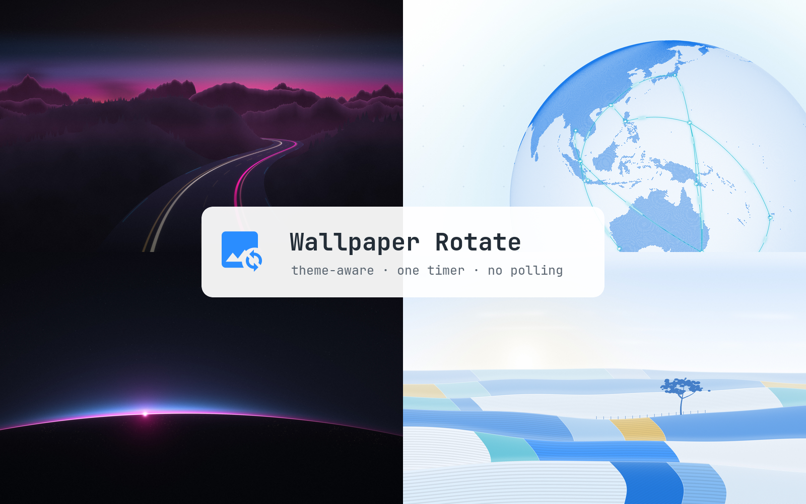

# Wallpaper Rotate



An Omarchy shell plugin that rotates the desktop background through the current theme's wallpapers on a timer.

It follows the theme: it rotates through the same images as `omarchy theme bg next`, which are the theme's own `backgrounds/` plus `~/.config/omarchy/backgrounds/<theme>/`. When the theme changes, for example on an automatic day/night switch, rotation carries on through the new theme's set.

## Overhead

There is close to none:

- No extra daemon. The timer is a single `Timer` inside the Omarchy shell that is already running.
- No polling. Nothing wakes between rotations; the bar tooltip works out the countdown when you hover.
- Each rotation runs `bin/wallrotate-next` once and hands the image to `omarchy-theme-bg-set`. The shell decodes the image and plays its normal 420 ms reveal.
- Timer rotations are skipped while the screen is locked, and optionally while on battery.

## Install

```bash
omarchy plugin add https://github.com/matt-shearing/omarchy-wallrotate.git --enable --yes
```

Or run `omarchy plugin add` without `--enable` and add the icon later from the bar settings. Enabling adds the icon to the right of the bar. Click for the next wallpaper, middle-click (or scroll up) for the previous one, and right-click to pause or resume. Paused state survives a shell restart.

## Remove

```bash
omarchy plugin remove contra.wallrotate --yes
rm -r ~/.local/state/contra-wallrotate   # the saved pause state
```

The plugin writes nothing else. It never edits `shell.json` and never touches your wallpaper files; it only changes which one is shown, through `omarchy-theme-bg-set`.

## Requirements

Omarchy 4 with the Quickshell shell. Everything else it uses ships with Omarchy: `bash`, `find`, `pgrep`, `omarchy-theme-bg-set` and `omarchy-shell`.

## Settings

Set these in the bar settings, or inline on the `contra.wallrotate` entry in `~/.config/omarchy/shell.json`:

| Key | Default | Meaning |
|---|---|---|
| `intervalMinutes` | `30` | Minutes between rotations |
| `shuffle` | `false` | Pick a random wallpaper instead of the next in order |
| `skipOnBattery` | `false` | Hold timer rotations while unplugged; clicks still work |

## IPC

```bash
omarchy-shell contra.wallrotate next
omarchy-shell contra.wallrotate previous
omarchy-shell contra.wallrotate shuffle
omarchy-shell contra.wallrotate pause
omarchy-shell contra.wallrotate resume
omarchy-shell contra.wallrotate togglePause
omarchy-shell contra.wallrotate status
omarchy-shell contra.wallrotate reload   # re-read settings from shell.json
```

`bin/wallrotate-next` also works on its own: `--shuffle`, `--prev`, `--auto` (skip while locked), `--skip-on-battery`.

## Notes

The plugin watches `shell.json` for setting changes. It also re-reads its settings on every rotation and whenever you hover the icon, because a file watch can stop silently. That happens when the file is replaced on save while the system's inotify watch limit (`fs.inotify.max_user_watches`) is used up. If other settings also stop applying until you restart the shell, check `journalctl --user -t omarchy-shell` for `inotify_add_watch ... No space left on device`.
